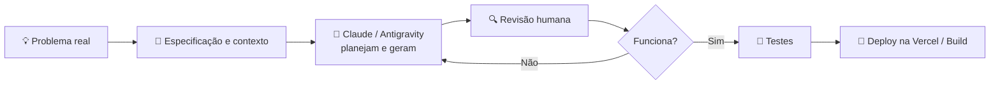

 

---

## 👋 Olá, eu sou o Pedro!

Sou **Técnico em Análise e Desenvolvimento de Sistemas**, líder de equipe de **suporte técnico remoto (helpdesk)** e estou construindo minha carreira como **Front-End Engineer**.

No dia a dia eu uso a **IA como copiloto de verdade**, e não só como autocompletar. Meus projetos nascem de problemas reais de operação, que viram sistemas web, extensões de navegador e automações.

- 🤖 Trabalho com **Claude** e **Antigravity** em fluxos agênticos: planejamento, geração de código, revisão e testes
- 🌐 Crio **sistemas web** com React, TypeScript e Next.js, publicados na Vercel
- 🎮 Desenvolvo **jogos com Unity (C#)**
- 🧩 Faço **extensões Chrome/Edge** e **automações** que economizam tempo da equipe
- 🎧 Vivo a rotina de suporte, então penso em **usabilidade e produtividade** antes de escrever a primeira linha

> 💡 *"A IA não substitui quem desenvolve. Ela multiplica quem sabe o que quer construir."*

---

## 🧭 Foco de atuação

<table>
  <tr>
    <td width="33%" valign="top">
      <h3>🤖 IA no desenvolvimento</h3>
      <ul>
        <li>Fluxos agênticos com Claude e Antigravity</li>
        <li>Engenharia de prompt e contexto</li>
        <li>Arquivos de regras (<code>CLAUDE.md</code>)</li>
        <li>Revisão e refatoração assistidas</li>
        <li>Automação de tarefas repetitivas</li>
      </ul>
    </td>
    <td width="33%" valign="top">
      <h3>🎮 Games com Unity</h3>
      <ul>
        <li>Gameplay e mecânicas em C#</li>
        <li>Protótipos e jogos completos</li>
        <li>Publicação e política de privacidade</li>
        <li>Scripts com apoio de IA</li>
        <li>Projeto em destaque: <b>Orb Rift</b></li>
      </ul>
    </td>
    <td width="33%" valign="top">
      <h3>🌐 Web com IA</h3>
      <ul>
        <li>Sistemas e dashboards responsivos</li>
        <li>PWAs e apps de gestão</li>
        <li>Integração com APIs e Firebase</li>
        <li>Deploy contínuo na Vercel</li>
        <li>Extensões Chrome/Edge</li>
      </ul>
    </td>
  </tr>
</table>

---

## 🛠️ Stack e ferramentas

### 🤖 Inteligência Artificial

### 🎮 Games

### 🌐 Web

### ☁️ Dados, deploy e ferramentas

---

## 🚀 Projetos em destaque

### 🎮 Games

<table>
  <tr>
    <td width="50%" valign="top">
      
       
      <b>Orb Rift:</b> página de política de privacidade do jogo · <b>Engine:</b> Unity
    </td>
  </tr>
</table>

### 🌐 Sistemas web

<table>
  <tr>
    <td width="50%" valign="top">
      
       
      Painel de suporte · <a href="https://hubdesk-xi.vercel.app">ver online</a>
    </td>
    <td width="50%" valign="top">
      
       
      Gestão financeira pessoal · <a href="https://app-gestao-financeira-three.vercel.app">ver online</a>
    </td>
  </tr>
  <tr>
    <td width="50%" valign="top">
      
       
      PWA de gestão de clientes de estética automotiva · <a href="https://foxdetailerappwebpwa.vercel.app">ver online</a>
    </td>
    <td width="50%" valign="top">
      
       
      Gerador de ordens de serviço do suporte · <a href="https://gerador-os-suporte.vercel.app">ver online</a>
    </td>
  </tr>
  <tr>
    <td width="50%" valign="top">
      
       
      Gerador de OS do comercial, v2 · <a href="https://etecc-os-comercial-v2.vercel.app">ver online</a>
    </td>
    <td width="50%" valign="top">
      
       
      🤖 Site criado com IA para ordens de serviço
    </td>
  </tr>
</table>

### 🧩 Extensões e automações

Além dos repositórios acima, mantenho **extensões para Chrome/Edge** (como o *SIP Agent Booster*, com HUD de qualidade de chamada, atalhos e mini-telefone flutuante) e **automações** (bots e extração de dados) que reduzem trabalho manual no suporte.

---

## 🧠 Meu fluxo de trabalho com IA

**Princípios que sigo:**

1. **Contexto antes de código.** Boa especificação gera bom resultado.
2. **Iteração curta.** Pequenos passos, validação constante.
3. **Eu reviso tudo.** A IA propõe, eu decido.
4. **Documentar o aprendizado.** Prompts e regras que funcionam viram arquivos reutilizáveis.
5. **Segurança primeiro.** Nunca expor chaves, tokens ou dados pessoais em prompts ou commits.

---

## 📊 Estatísticas do GitHub

  

---

## 🎯 Objetivos atuais

- [x] Dominar fluxos agênticos com Claude Code
- [x] Publicar sistemas web reais em produção na Vercel
- [ ] Consolidar a carreira como Front-End Engineer
- [ ] Publicar o Orb Rift
- [ ] Criar uma biblioteca pessoal de prompts e regras reutilizáveis

---

## 📫 Vamos conversar?

---

**🏷️ Tópicos:**
`inteligencia-artificial` · `claude` · `claude-code` · `antigravity` · `ai-coding` · `vibe-coding` · `unity` · `unity3d` · `csharp` · `game-dev` · `web-development` · `front-end` · `react` · `nextjs` · `typescript` · `firebase` · `vercel` · `chrome-extension` · `ai-agents` · `mcp`

 

⭐ Gostou de algum projeto? Deixe uma estrela!

